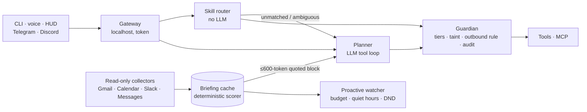
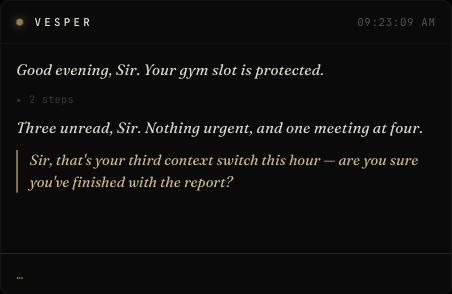
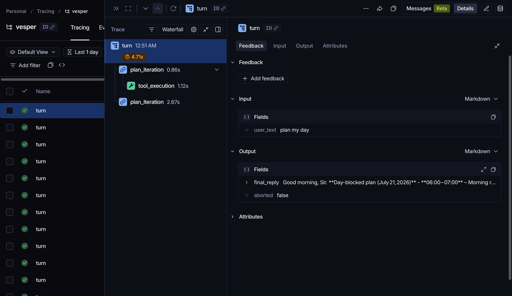

# Vesper

[](LICENSE)
[](https://github.com/ParrvLuthra22/vantage)

**A proactive AI chief of staff for macOS: it plans with an LLM, acts through a permission-gated tool registry, reads your
mail, calendar, Slack and texts without being able to change them, and speaks up only when it matters.**

Vesper runs on your Mac. A planner (Groq `gpt-oss-120b`) picks tools; a **Guardian** decides whether each call may run;
read-only **collectors** turn your inbox into a deterministic, explainable briefing; a **deterministic router** answers
the boring commands without calling a model at all. Voice in and out, a small always-on-top HUD, and chat channels
(Telegram, Discord) are all clients of one local gateway. Everything third-party — an email, a DM, a calendar title — is
treated as *data*, never as instructions.


*The HUD across one exchange: idle → wake flare → spoken greeting → tool traces → reply → the call-out → back to idle.*

> **Read next:** [DESIGN.md](docs/DESIGN.md) (architecture + decisions) · [SECURITY.md](docs/SECURITY.md) (threat model, with
> where each defense is tested) · [RESULTS.md](docs/RESULTS.md) (only measured numbers) · [DEMO.md](docs/DEMO.md) (a
> 3-minute walkthrough on synthetic data).

---

## Quickstart

Requires **macOS** and **Python 3.11** (use an explicit `python3.11`). The only cloud dependency is a free
[Groq](https://console.groq.com) key.

```bash
git clone <this-repo> vesper && cd vesper
python3.11 -m venv .venv && source .venv/bin/activate
pip install --upgrade pip && pip install -r requirements.txt && pip install -e .
echo "GROQ_API_KEY=..." >> .env

vesper doctor      # read-only environment check: prints PASS/WARN/FAIL with the fix under each; sends nothing, prints no secret
vesper up          # start and supervise the stack: gateway → voice output → HUD → wake word + speech-to-text
```

`vesper doctor` also reports whether your terminal could open Messages' database (it only tries to *open* the file; the
Messages collector is off unless you enable it). `vesper up` needs the optional voice/HUD pieces to be installed to start
them — a component that is missing is reported loudly and the rest keeps running ([LAUNCHER.md](docs/LAUNCHER.md)).

**No microphone, no HUD, no API key?** Try it on made-up data instead — this touches nothing of yours:

```bash
python scripts/demo_seed.py && export VESPER_BRIEFING_DB="$PWD/data/demo/briefing.db" VESPER_BRIEFING_CONFIG="$PWD/data/demo/briefing.yaml"
vesper briefing --explain --cache-only     # a ranked inbox, every point explained
vesper route "uh can you open safari please"   # which skill would answer this, and why (runs nothing)
```

`vesper` on its own opens a text REPL that uses no microphone. The optional extras (Kokoro voices, local rescue model,
building the HUD) are at the end of this file.

---

## What it does today

Everything in this table exists in the repository and has automated tests; the footnote says what has **not** been verified
live.

| Capability | What it is | Docs |
|---|---|---|
| **Planner + Guardian** | An LLM tool-calling loop over the tool registry (27 built-ins plus MCP servers). Every tool has a tier — `safe`, `draft`, `confirm`, `dangerous`; confirmations time out into denials; every non-safe verdict is audited. | [DESIGN](docs/DESIGN.md), [ARCHITECTURE](docs/ARCHITECTURE.md) |
| **Briefing** | Read-only Gmail and Calendar collectors → a deterministic 0–100 scorer (every point explained) → a SQLite cache → a ≤600-token quoted block and a ~25 s spoken script. The model never sees a raw inbox. | [BRIEFING](docs/BRIEFING.md) |
| **Slack and Messages collectors** | Unread DMs and mentions from Slack (six read methods, nothing else can be called); unread, unanswered iMessages from a read-only *copy* of `chat.db` with one-time codes masked at ingest. Both off until configured.¹ | [SLACK](docs/SLACK.md), [MESSAGES](docs/MESSAGES.md) |
| **Hostile-content handling** | Text that reads like instructions to an AI stores no snippet and is reported only as a count — "1 email filtered as unsafe" — for mail, Slack and Messages. | [SECURITY](docs/SECURITY.md) |
| **Skill router** | "What time is it", "open Safari", "volume up", "aaj ka schedule batao" answered with no LLM. 100 % precision on 59 utterances that must fall through; 53.8 % recall on phrasings nobody tuned for. `vesper route "…"` explains a decision. | [ROUTER](docs/ROUTER.md) |
| **Outbound-approval rule + draft tier** | Anything that delivers content to another person (or saves a mail draft), raised from Telegram or Discord, can only be approved on the Mac. `gmail_create_draft` can only create a draft, and Gmail has no delivery call at all.¹ | [SECURITY](docs/SECURITY.md) |
| **Proactive watcher** | Meeting in 30/5 minutes, a new high-priority item, a stale collector — under a hard daily budget, quiet hours (23:00–08:00 IST by default), cooldowns, persisted dedupe and `vesper dnd`. Notifications carry a source and a sender name, never message text. **Off by default.**¹ | [PROACTIVE](docs/PROACTIVE.md) |
| **Fail-closed redaction** | `vesper briefing --redact` prints placeholders, and withholds *everything* if any stored value would leak. | [BRIEFING](docs/BRIEFING.md), [PRIVACY](docs/PRIVACY.md) |
| **Semantic memory** | Chroma + local MiniLM embeddings; a session-end reflection pass stores at most five durable items. | [ARCHITECTURE](docs/ARCHITECTURE.md) §6 |
| **Voice and HUD** | openWakeWord → VAD → faster-whisper in; Kokoro out; a Tauri always-on-top panel with plan traces, call-outs and confirmation cards.² | [LAUNCHER](docs/LAUNCHER.md), [RESOURCES](docs/RESOURCES.md) |
| **Chat channels** | Telegram (its own process behind a restricted gateway door; off by default) and a Discord remote: owner-only, dangerous tools disabled, explicit request-id approval. Telegram approvals use single-use, user-bound nonces. | [CHANNELS](docs/CHANNELS.md) |
| **Launcher** | `vesper up / down / status / logs / doctor`: supervised start in dependency order, backoff, clean shutdown. | [LAUNCHER](docs/LAUNCHER.md) |

¹ Built and tested against **synthetic fixtures and mocks only** — never a live Slack workspace, a real `chat.db`, a real
Gmail draft, or a real notification. ² The stages are measured separately; the full microphone round trip is **not**
verified end to end. See *Known limitations*.

The test suite is **1,532 passing tests** (8 integration tests that need a live LLM are deselected by default). Numbers (footprint, latency, token counts, router and canary results) with their sources
are in [RESULTS.md](docs/RESULTS.md).

### Deliberately not built (and why)

* **A way to send email.** The Gmail integration can read, draft, archive and mark read — there is no delivery call, so a
  draft is something you send yourself. (The Slack and Discord MCP servers can post; they are off by default and their
  posting tools are flagged so that, raised from a remote channel, only the Mac can approve them.) The groundwork for ever
  adding sending — approval on the Mac only — comes first.
* **WhatsApp automation.** Automating a personal WhatsApp account risks a ban; the value does not justify a bricked account.
* **An autonomous browser agent.** A tool that can click anything on any page cannot be bounded by a per-tool permission tier.
* **A heavy always-on local LLM.** On an 8 GB M3 a 7B model swaps and drags the whole machine; Groq plans, a 3B local model
  is a rate-limit rescue only.

---

## Known limitations

Stated up front because they matter more than the feature list:

* **The voice path is not verified end to end live.** The measurements in [RESOURCES.md](docs/RESOURCES.md) could not drive
  the microphone (an acoustic loop did not trigger the wake word); wake word, speech-to-text, the gateway/planner path and
  speech output were each exercised separately. The wake word is the stock "Hey Jarvis" — "vesper" was never trained.
* **No live Slack workspace test has been done.** The Slack collector, the Messages collector, `gmail_create_draft` and the
  proactive watcher were all built against fixtures and mocks. The first real run is a checklist in
  [LIVE_VERIFICATION.md](docs/LIVE_VERIFICATION.md) and [SLACK.md](docs/SLACK.md).
* **Groq's free tier is the practical ceiling.** 8,000 tokens a minute; a multi-step turn is ~3 planner calls. Bursts fail
  with "I'm having trouble thinking right now". The local 3B rescue exists but needs ~2.3 GB and is slow to cold-load.
* **It is built for an 8 GB Mac and the margins are thin.** The always-on stack is ~0.75 GB idle (~1.1 GB with Kokoro
  preloaded), ~1.5–1.9 GB in use — on a machine that was already swapping when measured.
* **Prompt-injection defenses reduce risk; they do not remove it.** The tainted-input rule is turn-level and one rung; taint
  does not follow replayed conversation history. The approver identity on the event bus is a process-level trust boundary,
  not a signature. See [SECURITY.md](docs/SECURITY.md).
* **The router's recall on unseen phrasing is about half** (53.8 % on 39 phrasings it was not tuned for). It fails by
  falling through to the planner, never by misrouting — but it is not a general natural-language front end.
* **The routing eval is a single live run** (7/10 on `orchestrator_v1_smoke`, see *Evaluation*).
* **macOS only** (AppleScript, EventKit, `osascript`, Full Disk Access).

---

## Architecture in one picture



The full diagram, the permission and taint models, and eight design decisions with their reasoning:
[docs/DESIGN.md](docs/DESIGN.md).

---

## Evaluation

Routing behaviour — which agent or tool a turn should reach — is regression-tested on every PR that touches
`orchestrator/`, `tools/`, `llm/`, or `config/persona.md` by [Vantage](https://github.com/ParrvLuthra22/vantage), a
purpose-built eval harness that runs Vesper's planner end-to-end against real scenarios. See
[`.github/workflows/eval-gate.yml`](.github/workflows/eval-gate.yml) for the CI gate and
[`.github/eval-baseline.json`](.github/eval-baseline.json) for the committed baseline.

| Suite | Scenarios | Pass rate | Date | Commit |
|---|---|---|---|---|
| `orchestrator_v1_smoke` | 10 | 70% (7/10) | 2026-09-23 | [`1c779c5`](https://github.com/ParrvLuthra22/vesper/commit/1c779c514392eac03378b7624984f21b5d6f678a) |

That is a single live run against Groq. The committed baseline scores 90% (9/10) on the same code; the gap is model variance
on an unchanged prompt (one scenario fails in the baseline too), which is what a live LLM eval shows — reporting the number
the run actually produced is the point. Reproduce with:

```bash
vantage eval run vantage-src/packages/eval_engine/suites/orchestrator_v1_smoke \
  --adapter vesper --no-judge -v --output current.json
```

(needs [ParrvLuthra22/vantage](https://github.com/ParrvLuthra22/vantage) cloned alongside, its `sdk`/`api`/`eval_engine`
packages installed, and a `GROQ_API_KEY` — see [`eval-gate.yml`](.github/workflows/eval-gate.yml).) The deterministic
router has its own eval: `python tests/eval_router.py`.

---

## Screenshots

| HUD, live session | LangSmith trace tree |
|---|---|
|  |  |
| Serif voice lines over collapsed mono traces; the gold call-out is the only gold body text. | One turn: nested plan iterations and tool execution with real latencies. |

---

## Tech stack

Python 3.11 · Groq (`gpt-oss-120b`) with an Ollama `llama3.2:3b` rescue · Chroma + sentence-transformers · Model Context
Protocol · FastAPI + WebSockets · SQLite · Tauri 2 + TypeScript · openWakeWord · faster-whisper · Kokoro-82M · LangSmith
(opt-in).

---

## Optional extras — voice, HUD, local rescue

```bash
# Local LLM rescue for when Groq rate-limits. The 3B is deliberate — do not raise it to a 7B on an 8GB machine.
ollama pull llama3.2:3b
./scripts/ollama_env.sh        # OLLAMA_KEEP_ALIVE=30s so it unloads when idle and hands its ~2.3GB back

# Voice (model files are gitignored, ~340MB once):
pip install -r voice/requirements.txt
cd voice/models
curl -LO https://github.com/thewh1teagle/kokoro-onnx/releases/download/model-files-v1.0/kokoro-v1.0.onnx
curl -LO https://github.com/thewh1teagle/kokoro-onnx/releases/download/model-files-v1.0/voices-v1.0.bin

# Or, by hand, in separate terminals instead of `vesper up`:
python -m gateway.server                    # the brain
cd hud && npm install && npm run tauri dev  # the panel
python -m voice.input                       # wake word + STT
python -m voice.output                      # Kokoro TTS
```

`python scripts/doctor.py` checks every dependency and reports memory headroom before you start a local model. To verify a
fresh install end to end against your real accounts, follow [LIVE_VERIFICATION.md](docs/LIVE_VERIFICATION.md).

Opt-in integrations, each off until you configure it: Slack ([SLACK.md](docs/SLACK.md)), Messages / Full Disk Access
([MESSAGES.md](docs/MESSAGES.md)), the proactive watcher ([PROACTIVE.md](docs/PROACTIVE.md)), Telegram
([CHANNELS.md](docs/CHANNELS.md)).

---

## Documentation

[Design](docs/DESIGN.md) · [Security](docs/SECURITY.md) · [Results](docs/RESULTS.md) · [Demo](docs/DEMO.md) ·
[Architecture](docs/ARCHITECTURE.md) · [Briefing engine](docs/BRIEFING.md) · [Skill router](docs/ROUTER.md) ·
[Proactive watcher](docs/PROACTIVE.md) · [Slack](docs/SLACK.md) · [Messages](docs/MESSAGES.md) ·
[Chat channels](docs/CHANNELS.md) · [Launcher](docs/LAUNCHER.md) · [Privacy](docs/PRIVACY.md) ·
[Resource profile](docs/RESOURCES.md) · [Live verification](docs/LIVE_VERIFICATION.md) · [Test plan](docs/TESTPLAN.md) ·
[Voice demo script](docs/DEMO_SCRIPT.md) · [Wake-word training](voice/TRAINING.md) · [Voice output](voice/output/README.md)

```bash
pytest    # 1,532 passed, 8 deselected
```

---

## License

[MIT](LICENSE) © 2026 Parrv Luthra
